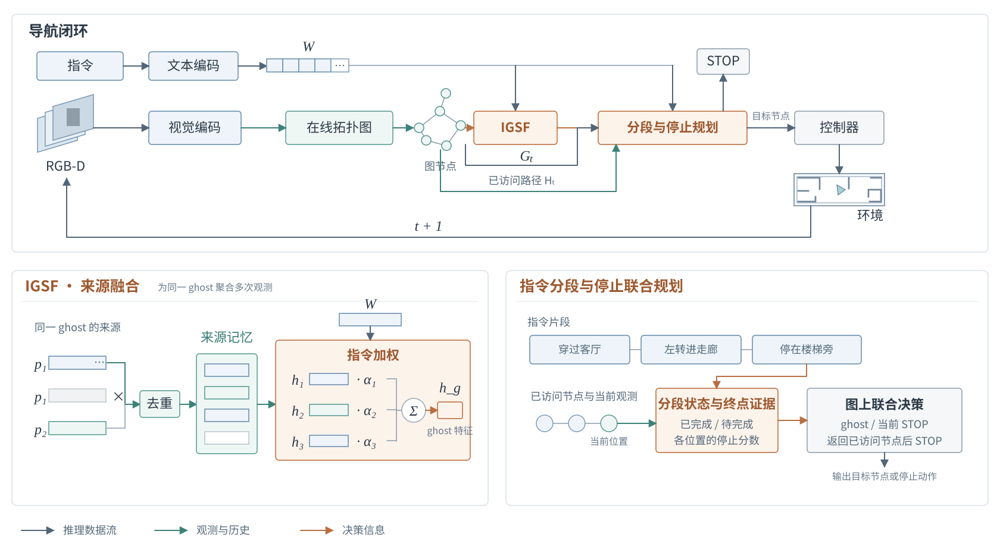

# FSP-Nav：来源特征融合与指令分段停止规划

**状态：方法设计，尚无本项目实验结果。** 本文基于 ETPNav 的在线拓扑图与连续环境控制框架，研究两个可独立检验的改动。文中的效果判断均需通过闭环实验验证。

图 1. 上方为导航闭环，下方分别说明同一 ghost 的来源特征融合，以及指令分段与停止位置的联合决策。图中仅画推理时可获得的信息；终点位置仅用于训练和评估。

## 1. 研究问题

ETPNav 将同一 ghost 的多次候选观测特征取平均。不同观测视角的可见地标可能不同，平均可能冲淡与指令相关的线索。这里的“来源”是**从不同观测位姿看到同一未访问 ghost 的候选特征**，不是在 ghost 位置拍摄的图像。[ETPNav](https://arxiv.org/pdf/2304.03047)

另一问题是停止决策。ETPNav 在 R2R-CE val-unseen 上报告 OSR 65%、SR 57%；两者差距表明部分轨迹曾进入终点附近，却未在合适位置结束。它不能直接证明所有案例都是“走过头”，需要逐条轨迹核实。原方法已有 STOP 节点、全局回退与删除已选 ghost 的机制，不能把这些能力写成新贡献。[ETPNav，表 2 与 §3.2–3.3](https://arxiv.org/pdf/2304.03047)

## 2. 方法

### 2.1 IGSF：指令引导的来源特征融合

对同一 ghost 保留少量来自不同观测位姿的候选记录，记录候选特征、来源位置及朝向。相近位姿的重复记录合并；存储容量有上限。以编码后的指令为条件，对保留的来源特征计算权重并加权融合，产生一个 ghost 特征，送入原图规划器。首版只替换 ghost 的特征聚合，不改变 ghost 的位置、数量或控制器。

来源权重由小型可训练评分网络产生，而不是人为指定。训练使用原有导航动作监督；推理只使用指令、在线观测和当前图。必须与原始均值、去重后均值等简单规则比较，确认学习式权重确有必要。

### 2.2 指令分段与停止联合规划

将指令按动作和地标划为有序片段，例如“穿过客厅｜左转进走廊｜停在楼梯旁”。模型结合已访问节点和当前观测，软估计各片段的执行状态；再结合最后一段的视觉证据，对当前及已访问节点产生停止位置分数。图规划器统一比较：继续选择 ghost、在当前位置 STOP、返回某个已访问节点后 STOP。

片段状态是可修正的软分数，不能因为一次误判就永久跳过某段。训练阶段可用已有轨迹和终点标注监督导航与停止位置；推理阶段**不使用真实终点位置或到目标测地距离**。原方法已有 STOP 与回退，因此拟研究的增量是**让分段进度和终点证据共同影响停止位置选择**，而不是首次提出停止或指令进度。[Progress-Think](https://arxiv.org/abs/2511.17097) 已研究语义进度，本文不能将“指令分段”单独宣称为创新。

## 3. 实验设计

**数据集。** R2R-CE 为主实验；在资源和多语言分段实现允许时，用 RxR-CE 做泛化验证。训练只用训练划分；参数及方案选择在验证划分完成；测试集只作最终报告。两者与 ETPNav 的任务环境一致。[ETPNav，§4.1](https://arxiv.org/pdf/2304.03047)

**四组消融**在相同 checkpoint 起点、传感器、候选生成、控制协议和 episode 列表下进行：

| 组别 | IGSF | 分段＋STOP |
| --- | :---: | :---: |
| 原始 ETPNav | — | — |
| 仅 IGSF | ✓ | — |
| 仅分段＋STOP | — | ✓ |
| FSP-Nav 完整方法 | ✓ | ✓ |

**主指标。** R2R-CE 报告 SR、SPL，并列出 NE、OSR、TL；RxR-CE 另报告 nDTW、sDTW。重点观察完整方法是否同时提高 SR 与 SPL，而非只延长轨迹。[ETPNav，§4.1](https://arxiv.org/pdf/2304.03047)

**机制检验。** 对 IGSF 统计同一 ghost 的有效不同来源占比，比较均值、去重均值与学习权重。对停止模块筛选“轨迹曾进入终点 3 米内但最终失败”的 episode，比较过早停止、经过后未停、返回后成功三类数量；对比停止前后的分段状态及停止位置分数。OSR–SR 差距只用于确定分析方向，不直接当成新模块可恢复的收益。

## 4. 论文案例图

1. **来源融合案例：**同一 episode 的拓扑图、一个 ghost 的 2～3 条真实来源观测及模型权重、基线与新方法的候选选择和后续轨迹。
2. **停止规划案例：**同一任务的两条真实轨迹，在关键节点标出分段状态、停止位置分数以及“继续／返回／STOP”的实际动作。

权重、分数和预测轨迹必须从模型日志读取；数据集参考轨迹只作为参考，不可冒充模型输出。当前仓库尚无 `data/` 目录、导航 checkpoint 或逐 episode 推理日志，因此案例图需在模型运行后生成。

## 5. 实施顺序与风险

先核实数据集、Habitat 场景和 checkpoint，复现 ETPNav 并保存逐 episode 的动作与位置轨迹。随后统计真实多来源事件和停止错误，再训练两个模块，完成四组消融。若某类事件很少、简单规则已解决问题，或闭环指标无改善，应收缩相应贡献主张。
